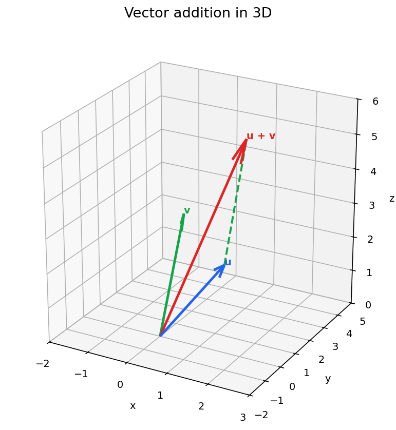

# Exercise 1. Vector Operations and Their Meaning

## Question

For $u=(2,-1,3)$ and $v=(-1,4,2)$, compute

$$
u+v,\qquad u-v,\qquad 3u-2v.
$$

Then verify that $(u+v)-v=u$, and explain geometrically what adding two vectors means.

## Solution

### Given

The vectors are $u=(2,-1,3)$ and $v=(-1,4,2)$ in three-dimensional space.

### Find

The sum $u+v$, difference $u-v$, linear combination $3u-2v$, an algebraic verification of $(u+v)-v=u$, and the geometric meaning of vector addition.

### Method and steps

**Step 1. Add corresponding coordinates.** Vector addition acts independently on the $x$-, $y$-, and $z$-coordinates:

$$
\begin{aligned}
u+v &= (2+(-1),\;-1+4,\;3+2) \\
    &= (1,3,5).
\end{aligned}
$$

**Step 2. Subtract corresponding coordinates.** Subtracting $v$ is the same as adding the opposite vector $-v$:

$$
\begin{aligned}
u-v &= (2-(-1),\;-1-4,\;3-2) \\
    &= (3,-5,1).
\end{aligned}
$$

**Step 3. Form the requested linear combination.** First multiply the vectors by their scalar coefficients:

$$
3u=(6,-3,9),\qquad 2v=(-2,8,4).
$$

Subtracting these two vectors gives

$$
\begin{aligned}
3u-2v &= (6-(-2),\;-3-8,\;9-4) \\
     &= (8,-11,5).
\end{aligned}
$$

**Step 4. Verify the addition rule.** Substitute the sum obtained in Step 1:

$$
\begin{aligned}
(u+v)-v &= (1,3,5)-(-1,4,2) \\
        &= (1+1,\;3-4,\;5-2) \\
        &= (2,-1,3)=u.
\end{aligned}
$$

The original vector is recovered, so the check succeeds.

**Step 5. Interpret the operation geometrically.** Place the tail of $v$ at the tip of $u$. The arrow from the original tail of $u$ to the final tip is $u+v$. Equivalently, $u$ and $v$ can be drawn from the same starting point, and their sum is the diagonal of the parallelogram determined by them. The order of addition does not change this resultant vector.

### Answer

$$
u+v=(1,3,5),\qquad u-v=(3,-5,1),\qquad 3u-2v=(8,-11,5).
$$

The identity $(u+v)-v=u$ holds, and geometric addition follows the head-to-tail or parallelogram rule.

## Geometric visualization

The diagram illustrates the geometric relationships used in the solution. For three-dimensional figures, the view is a perspective projection; the stated coordinates and calculations remain exact.
