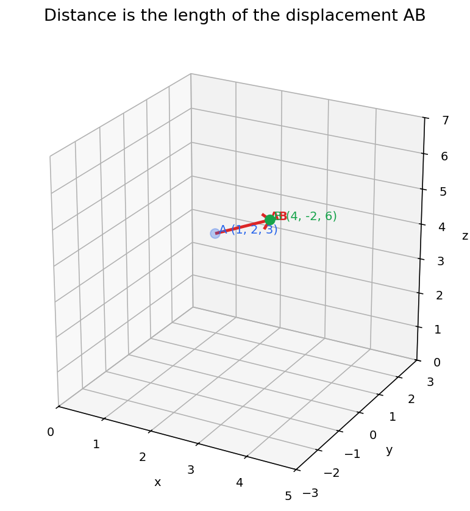

# Exercise 2. Distance as the Length of a Vector

## Question

The points are $A=(1,2,3)$ and $B=(4,-2,6)$.

1. Construct $\overrightarrow{AB}$.
2. Compute its length.
3. Compute the distance between the points using the coordinate formula.
4. Explain why both calculations give the same result.

## Solution

### Given

$A=(1,2,3)$ and $B=(4,-2,6)$.

### Find

The displacement vector from $A$ to $B$, its norm, the distance $d(A,B)$, and the reason the two lengths agree.

### Method and steps

**Step 1. Construct the displacement vector.** A vector from a starting point $A$ to an ending point $B$ is formed by subtracting the coordinates of $A$ from those of $B$:

$$
\begin{aligned}
\overrightarrow{AB} &= B-A \\
 &= (4-1,\;-2-2,\;6-3) \\
 &= (3,-4,3).
\end{aligned}
$$

This displacement describes moving 3 units along $x$, 4 units in the negative $y$-direction, and 3 units along $z$.

**Step 2. Find its length.** The Euclidean norm of a vector $(a,b,c)$ is $\sqrt{a^2+b^2+c^2}$:

$$
\begin{aligned}
\|\overrightarrow{AB}\| &= \sqrt{3^2+(-4)^2+3^2} \\
 &=\sqrt{9+16+9}=\sqrt{34}.
\end{aligned}
$$

**Step 3. Apply the point-distance formula independently.** For two points in three-dimensional space,

$$
d(A,B)=\sqrt{(x_B-x_A)^2+(y_B-y_A)^2+(z_B-z_A)^2}.
$$

Substitution gives

$$
\begin{aligned}
d(A,B) &=\sqrt{(4-1)^2+(-2-2)^2+(6-3)^2} \\
&=\sqrt{3^2+(-4)^2+3^2}=\sqrt{34}.
\end{aligned}
$$

**Step 4. Explain the agreement.** The coordinate differences in the distance formula are exactly the components of $\overrightarrow{AB}$. Consequently, the formula for distance is simply the norm formula applied to the difference vector $B-A$.

**Verification.** Reversing the endpoints gives $\overrightarrow{BA}=(-3,4,-3)=-\overrightarrow{AB}$. Its length is also $\sqrt{34}$, as a distance should be independent of the direction in which the segment is traversed.

### Answer

$$
\overrightarrow{AB}=(3,-4,3),\qquad \|\overrightarrow{AB}\|=d(A,B)=\sqrt{34}.
$$

## Geometric visualization

The diagram illustrates the geometric relationships used in the solution. For three-dimensional figures, the view is a perspective projection; the stated coordinates and calculations remain exact.
