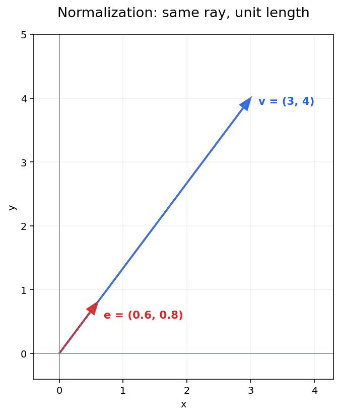

# Exercise 3. Vector Normalization

## Question

For $v=(3,4)$, find a unit vector $e$ with the same direction and orientation. Check that $\|e\|=1$, reconstruct $v$ in the form $v=\|v\|e$, and explain what changes during normalization and what remains unchanged.

## Solution

### Given

The nonzero vector $v=(3,4)$ in the plane.

### Find

A unit vector in the same direction and orientation, a norm check, a reconstruction of $v$, and a geometric interpretation of normalization.

### Method and steps

**Step 1. Compute the original length.** By the Pythagorean theorem,

$$
\|v\|=\sqrt{3^2+4^2}=\sqrt{9+16}=5.
$$

**Step 2. Divide by the length.** Normalization means dividing a nonzero vector by its Euclidean norm:

$$
\begin{aligned}
e &= \frac{v}{\|v\|} = \frac{1}{5}(3,4) \\
  &= \left(\frac35,\frac45\right).
\end{aligned}
$$

The scalar $1/5$ is positive, so the vector keeps its direction and orientation.

**Step 3. Verify the unit length.** Squaring and adding the coordinates gives

$$
\begin{aligned}
\|e\| &= \sqrt{\left(\frac35\right)^2+\left(\frac45\right)^2} \\
 &= \sqrt{\frac9{25}+\frac{16}{25}} \\
 &=\sqrt{1}=1.
\end{aligned}
$$

**Step 4. Reconstruct the original vector.** Multiplying the unit vector by the original length restores $v$:

$$
\|v\|e=5\left(\frac35,\frac45\right)=(3,4)=v.
$$

**Step 5. Interpret the change.** Normalization changes the length from $5$ to $1$ but keeps the line of action and the orientation of the arrow. In the diagram, $e$ and $v$ lie on the same ray starting at the origin. Normalization is undefined for the zero vector because its norm is zero.

### Answer

$$
e=\left(\frac35,\frac45\right),\qquad \|e\|=1,\qquad v=5e.
$$

## Geometric visualization

The diagram illustrates the geometric relationships used in the solution. For three-dimensional figures, the view is a perspective projection; the stated coordinates and calculations remain exact.
