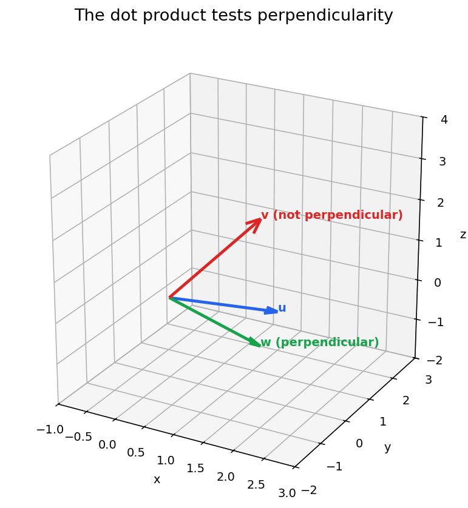

# Exercise 4. Dot Product and Perpendicularity

## Question

For $u=(1,2,-1)$ and $v=(2,-1,3)$, compute $u\cdot v$ and determine whether the vectors are perpendicular. Then find $a$ so that $w=(2,-1,a)$ is perpendicular to $u$, and check the result.

## Solution

### Given

$u=(1,2,-1)$, $v=(2,-1,3)$, and $w=(2,-1,a)$, where $a$ is unknown.

### Find

The dot product $u\cdot v$, whether $u$ and $v$ are perpendicular, and the value of $a$ for which $u\cdot w=0$.

### Method and steps

**Step 1. Recall the dot-product formula.** For vectors with three coordinates,

$$
(a_1,a_2,a_3)\cdot(b_1,b_2,b_3)=a_1b_1+a_2b_2+a_3b_3.
$$

The dot product is zero for nonzero perpendicular vectors.

**Step 2. Test $u$ and $v$.** Multiply corresponding coordinates and add:

$$
\begin{aligned}
u\cdot v &= 1\cdot2+2\cdot(-1)+(-1)\cdot3 \\
&=2-2-3=-3.
\end{aligned}
$$

Because $u\cdot v=-3\neq0$, the vectors are **not perpendicular**. The negative sign additionally indicates that their angle is obtuse.

**Step 3. Construct a perpendicular vector.** Impose the equation $u\cdot w=0$:

$$
\begin{aligned}
u\cdot w &= 1\cdot2+2\cdot(-1)+(-1)\cdot a \\
&=2-2-a=-a.
\end{aligned}
$$

For perpendicularity, $-a=0$, hence $a=0$ and $w=(2,-1,0)$.

**Step 4. Check the constructed vector.** Recalculate using the final coordinates:

$$
u\cdot w=1\cdot2+2\cdot(-1)+(-1)\cdot0=2-2+0=0.
$$

Both $u$ and $w$ are nonzero. Thus, by the dot-product criterion, they meet at a right angle.

### Answer

$$
u\cdot v=-3\neq0,\qquad a=0,\qquad w=(2,-1,0),\qquad u\cdot w=0.
$$

## Geometric visualization

The diagram illustrates the geometric relationships used in the solution. For three-dimensional figures, the view is a perspective projection; the stated coordinates and calculations remain exact.
