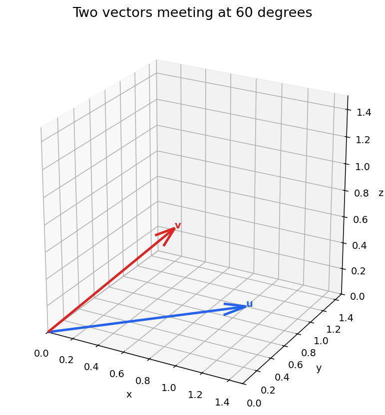

# Exercise 5. Angle Between Vectors

## Question

Given $u=(1,1,0)$ and $v=(1,0,1)$:

1. Use the sign of $u\cdot v$ to predict the type of angle.
2. Compute the angle.
3. Compare the result with the prediction.

## Solution

### Given

The nonzero vectors $u=(1,1,0)$ and $v=(1,0,1)$.

### Find

A prediction based on the sign of their dot product, the exact angle between them, and a comparison of prediction and calculation.

### Method and steps

**Step 1. Determine the sign of the dot product.** The dot product is

$$
\begin{aligned}
u\cdot v &= 1\cdot1+1\cdot0+0\cdot1 \\
&=1.
\end{aligned}
$$

The result is positive. Since $u\cdot v=\|u\|\,\|v\|\cos\theta$ and both norms are positive, $\cos\theta>0$. Therefore the angle between the vectors must be **acute**.

**Step 2. Calculate each length.** By the Euclidean norm formula,

$$
\begin{aligned}
\|u\| &= \sqrt{1^2+1^2+0^2}=\sqrt2, \\
\|v\| &= \sqrt{1^2+0^2+1^2}=\sqrt2.
\end{aligned}
$$

**Step 3. Use the angle formula.** For two nonzero vectors,

$$
\cos\theta=\frac{u\cdot v}{\|u\|\,\|v\|}.
$$

Thus

$$
\begin{aligned}
\cos\theta &=\frac{1}{\sqrt2\sqrt2} \\
&=\frac12.
\end{aligned}
$$

Since the angle between vectors is taken in the interval from $0$ to $180$ degrees,

$$
\theta=\arccos\left(\frac12\right)=60^\circ=\frac\pi3.
$$

**Step 4. Compare.** The calculated angle $60^\circ$ is less than $90^\circ$, so it is acute. This agrees with the prediction from Step 1.

### Answer

$$
u\cdot v=1>0,\qquad \theta=60^\circ=\frac\pi3.
$$

## Geometric visualization

The diagram illustrates the geometric relationships used in the solution. For three-dimensional figures, the view is a perspective projection; the stated coordinates and calculations remain exact.
