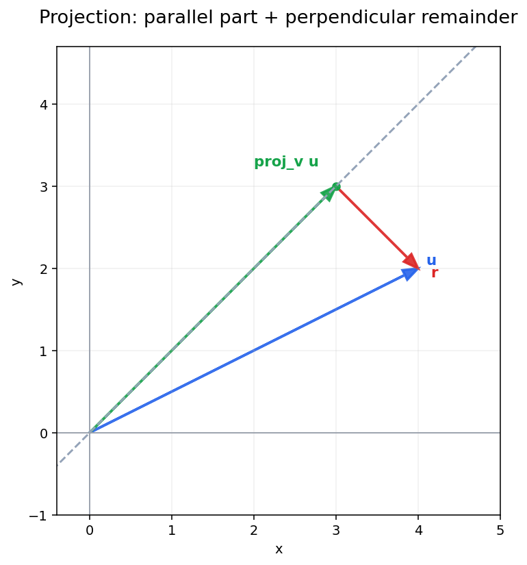

# Exercise 6. Projection and Perpendicular Component

## Question

Find the projection of $u=(4,2)$ onto the direction $v=(1,1)$. Then compute

$$
r=u-\mathrm{proj}_v\,u
$$

and verify that $r\cdot v=0$. Explain this result geometrically.

## Solution

### Given

$u=(4,2)$ and $v=(1,1)$. The vector $v$ is nonzero, so projection onto its direction is defined.

### Find

The vector projection of $u$ onto $v$, the remainder $r$, an orthogonality check, and the geometric meaning of the decomposition.

### Method and steps

**Step 1. Recall the projection formula.** The projection of $u$ onto the direction of $v$ is the part of $u$ parallel to $v$:

$$
\mathrm{proj}_v\,u=\frac{u\cdot v}{v\cdot v}v.
$$

**Step 2. Compute the two dot products.** Use coordinate multiplication:

$$
\begin{aligned}
u\cdot v &= 4\cdot1+2\cdot1=6, \\
v\cdot v &= 1^2+1^2=2.
\end{aligned}
$$

Therefore the scalar projection coefficient is $6/2=3$.

**Step 3. Find the vector projection.** Multiply $v$ by the coefficient:

$$
\mathrm{proj}_v\,u=\frac62(1,1)=3(1,1)=(3,3).
$$

**Step 4. Find the perpendicular remainder.** Subtract the parallel part from $u$:

$$
\begin{aligned}
r &= u-\mathrm{proj}_v\,u \\
 &= (4,2)-(3,3) \\
 &= (1,-1).
\end{aligned}
$$

**Step 5. Verify perpendicularity and reconstruction.** Direct multiplication gives

$$
r\cdot v=(1,-1)\cdot(1,1)=1-1=0.
$$

Also, the two components add back to the original vector:

$$
(3,3)+(1,-1)=(4,2)=u.
$$

**Geometric interpretation.** The vector $(3,3)$ lies along the line spanned by $v$. The remainder $(1,-1)$ runs from the tip of the projection to the tip of $u$ and is perpendicular to this line. These vectors form the legs of a right triangle with $u$ as its hypotenuse.

### Answer

$$
\mathrm{proj}_v\,u=(3,3),\qquad r=(1,-1),\qquad r\cdot v=0.
$$

## Geometric visualization

The diagram illustrates the geometric relationships used in the solution. For three-dimensional figures, the view is a perspective projection; the stated coordinates and calculations remain exact.
