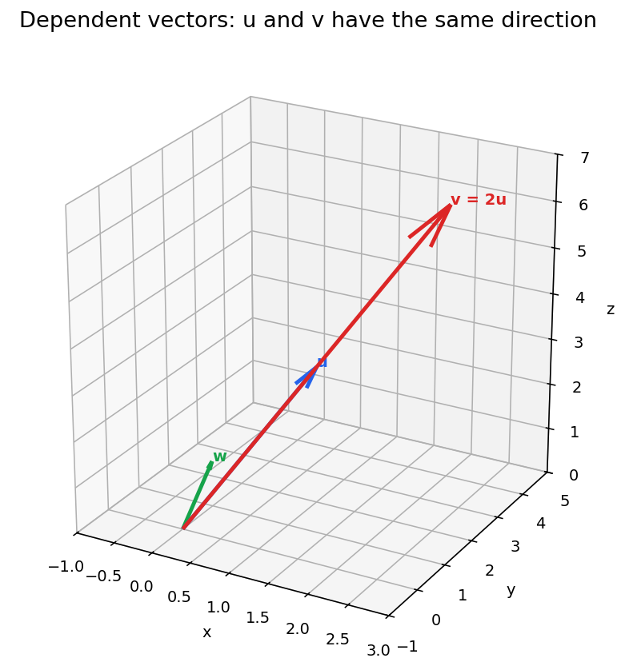

# Exercise 7. Linear Dependence Without Heavy Computation

## Question

Given

$$
u=(1,2,3),\qquad v=(2,4,6),\qquad w=(0,1,1).
$$

Identify a specific relation between $u$ and $v$, decide whether the three vectors can be linearly independent, and explain why no long calculation is needed.

## Solution

### Given

Three vectors in $\mathbb R^3$:

$$
u=(1,2,3),\qquad v=(2,4,6),\qquad w=(0,1,1).
$$

### Find

A relation between $u$ and $v$, a conclusion about independence of the set $\{u,v,w\}$, and an explanation that avoids unnecessary elimination.

### Method and steps

**Step 1. Compare the coordinates of $u$ and $v$.** Multiply every coordinate of $u$ by $2$:

$$
2u=2(1,2,3)=(2,4,6)=v.
$$

Thus $u$ and $v$ are parallel, with $v$ twice as long as $u$ and pointing in the same direction.

**Step 2. Write a nontrivial linear relation.** Move all terms to one side:

$$
2u-v+0w=(0,0,0).
$$

The coefficients $2$, $-1$, and $0$ are not all zero.

**Step 3. Apply the definition of dependence.** A set of vectors is linearly dependent when a linear combination equals the zero vector with at least one nonzero coefficient. The relation in Step 2 satisfies this definition, so the three vectors are linearly dependent regardless of the value of $w$.

**Step 4. Explain the geometric structure.** The vectors $u$ and $v$ are on the same line through the origin. Because $v$ contributes no new direction beyond $u$, the three-vector set cannot contain three independent directions. Computing a determinant or performing Gaussian elimination would merely reproduce the dependence already visible in $v=2u$.

**Verification.** Checking each coordinate of $2u-v$ gives $(2-2,4-4,6-6)=(0,0,0)$.

### Answer

$$
v=2u,\qquad 2u-v+0w=0.
$$

The vectors $u,v,w$ are linearly dependent.

## Geometric visualization

The diagram illustrates the geometric relationships used in the solution. For three-dimensional figures, the view is a perspective projection; the stated coordinates and calculations remain exact.
