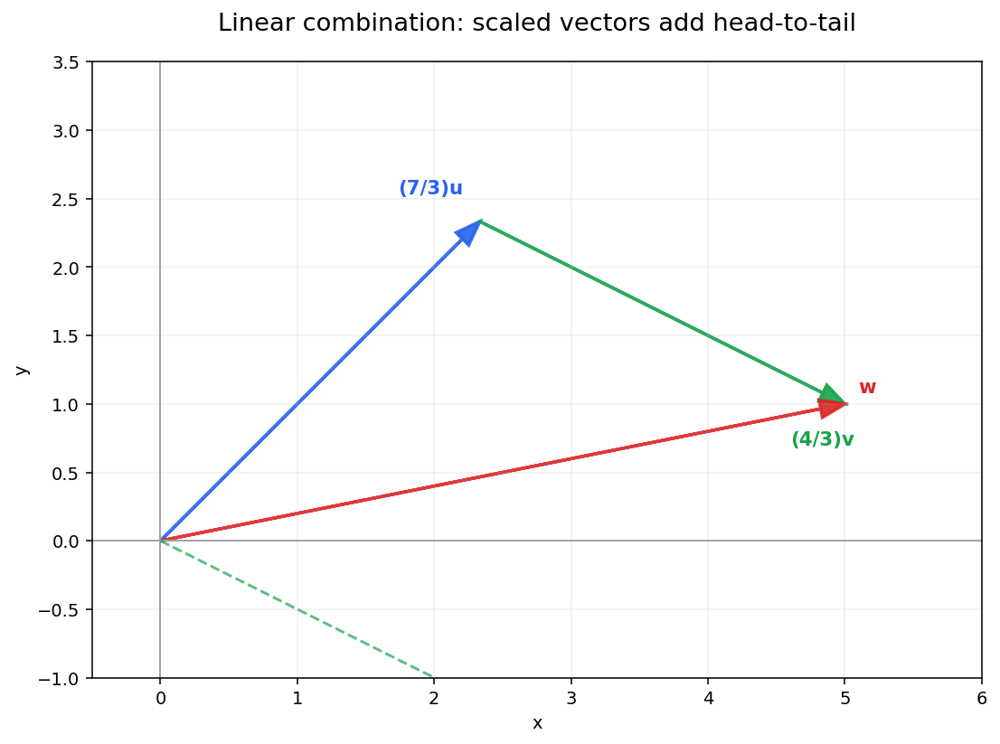

# Exercise 8. Linear Combination and Checking the Result

## Question

Check whether $w=(5,1)$ can be written as

$$
w=au+bv,
$$

where $u=(1,1)$ and $v=(2,-1)$. If so, find $a,b$, reconstruct $w$ from them, and explain the geometric meaning of the existence of such coefficients.

## Solution

### Given

$w=(5,1)$, $u=(1,1)$, and $v=(2,-1)$.

### Find

Whether $w$ is a linear combination of $u$ and $v$, the exact coefficients $a,b$, a substitution check, and the geometric interpretation.

### Method and steps

**Step 1. Translate vector equality into coordinate equations.** Assume $w=au+bv$. Then

$$
\begin{aligned}
au+bv &= a(1,1)+b(2,-1) \\
&=(a,a)+(2b,-b) \\
&=(a+2b,a-b).
\end{aligned}
$$

Equating the coordinates with $w=(5,1)$ gives

$$
\begin{cases}
a+2b=5, \\
a-b=1.
\end{cases}
$$

**Step 2. Solve for the coefficients.** Subtract the second equation from the first:

$$
(a+2b)-(a-b)=5-1.
$$

Therefore $3b=4$, giving $b=4/3$. Substitute into $a-b=1$:

$$
a=1+\frac43=\frac73.
$$

**Step 3. Reconstruct $w$ and verify.** Calculate the two scaled vectors separately:

$$
\frac73u=\left(\frac73,\frac73\right),\qquad \frac43v=\left(\frac83,-\frac43\right).
$$

Adding their coordinates gives

$$
\begin{aligned}
\frac73u+\frac43v &=\left(\frac73+\frac83,\frac73-\frac43\right) \\
&=\left(\frac{15}{3},\frac33\right)=(5,1)=w.
\end{aligned}
$$

**Step 4. Explain the geometry.** The vectors $u$ and $v$ are not parallel: their component ratios are different, or equivalently the determinant $1(-1)-1(2)=-3$ is nonzero. Consequently, they form two independent directions in the plane. Every planar vector, including $w$, can be expressed as a linear combination of them. Geometrically, the scaled vectors $\tfrac73u$ and $\tfrac43v$ can be placed head-to-tail to reach $w$.

### Answer

$$
a=\frac73,\qquad b=\frac43,\qquad w=\frac73u+\frac43v=(5,1).
$$

## Geometric visualization

The diagram illustrates the geometric relationships used in the solution. For three-dimensional figures, the view is a perspective projection; the stated coordinates and calculations remain exact.
