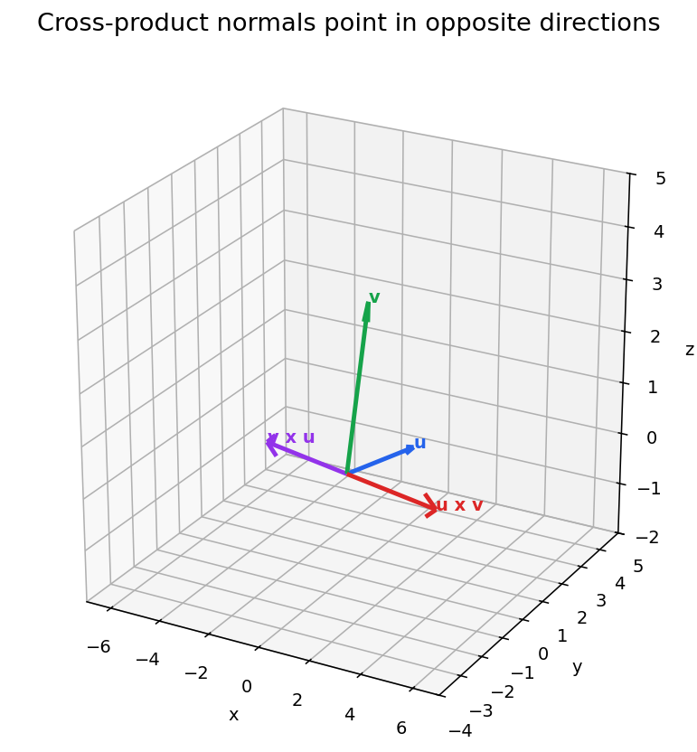

# Exercise 9. Cross Product as a Perpendicular Direction

## Question

For $u=(1,2,0)$ and $v=(0,1,3)$, compute $u\times v$. Use dot products to check perpendicularity to both vectors, compute $v\times u$, and compare the results.

## Solution

### Given

$u=(1,2,0)$ and $v=(0,1,3)$ in $\mathbb R^3$.

### Find

The two cross products in opposite orders, their perpendicularity checks, and the geometric significance of their signs.

### Method and steps

**Step 1. Recall the cross-product formula.** For $u=(u_1,u_2,u_3)$ and $v=(v_1,v_2,v_3)$,

$$
u\times v=(u_2v_3-u_3v_2,\;u_3v_1-u_1v_3,\;u_1v_2-u_2v_1).
$$

The resulting vector is perpendicular to both original vectors.

**Step 2. Calculate $u\times v$.** Substitute the given coordinates:

$$
\begin{aligned}
u\times v &=(2\cdot3-0\cdot1,\;0\cdot0-1\cdot3,\;1\cdot1-2\cdot0) \\
&=(6,-3,1).
\end{aligned}
$$

**Step 3. Check perpendicularity to $u$.** Using the dot product,

$$
(u\times v)\cdot u=(6,-3,1)\cdot(1,2,0)=6-6+0=0.
$$

**Step 4. Check perpendicularity to $v$.** Similarly,

$$
(u\times v)\cdot v=(6,-3,1)\cdot(0,1,3)=0-3+3=0.
$$

Both dot products vanish, confirming perpendicularity.

**Step 5. Reverse the order.** Exchange the two arguments in the cross-product formula:

$$
\begin{aligned}
v\times u &=(1\cdot0-3\cdot2,\;3\cdot1-0\cdot0,\;0\cdot2-1\cdot1) \\
&=(-6,3,-1).
\end{aligned}
$$

Therefore $v\times u=-(u\times v)$. The vectors have the same length but opposite directions: reversing the order reverses the normal direction specified by the right-hand rule.

### Answer

$$
u\times v=(6,-3,1),\qquad v\times u=(-6,3,-1).
$$

The cross product is perpendicular to both input vectors, and it changes sign when the inputs are exchanged.

## Geometric visualization

The diagram illustrates the geometric relationships used in the solution. For three-dimensional figures, the view is a perspective projection; the stated coordinates and calculations remain exact.
