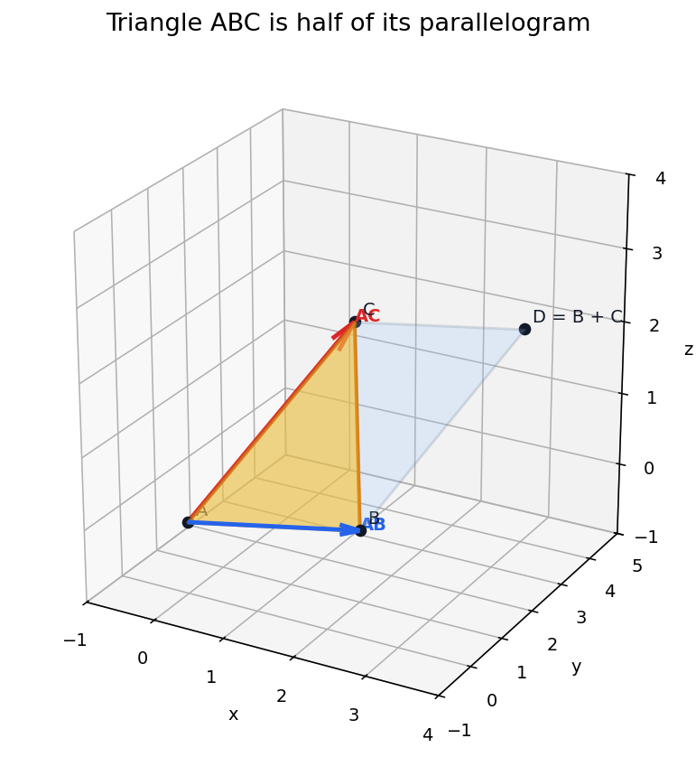

# Exercise 10. Triangle Area from Vectors

## Question

The points $A=(0,0,0)$, $B=(2,1,0)$, and $C=(1,3,2)$ form a triangle. Construct $\overrightarrow{AB}$ and $\overrightarrow{AC}$, compute the area of the parallelogram using the cross product, and then find the area of the triangle. Explain the factor $\frac12$.

## Solution

### Given

The vertices of the triangle are $A=(0,0,0)$, $B=(2,1,0)$, and $C=(1,3,2)$.

### Find

The edge vectors from $A$, the cross product of those edges, the area of the parallelogram spanned by them, and the triangle area with an explanation of the factor $1/2$.

### Method and steps

**Step 1. Construct the edge vectors.** Subtract the coordinates of $A$ from those of $B$ and $C$:

$$
\begin{aligned}
\overrightarrow{AB} &=B-A=(2-0,1-0,0-0)=(2,1,0), \\
\overrightarrow{AC} &=C-A=(1-0,3-0,2-0)=(1,3,2).
\end{aligned}
$$

Both vectors start at the same vertex $A$, so they are the adjacent sides of a parallelogram.

**Step 2. Compute their cross product.** Use the coordinate formula for the cross product:

$$
\begin{aligned}
\overrightarrow{AB}\times\overrightarrow{AC}
&=(1\cdot2-0\cdot3,\;0\cdot1-2\cdot2,\;2\cdot3-1\cdot1) \\
&=(2,-4,5).
\end{aligned}
$$

**Step 3. Find the parallelogram area.** For vectors $p$ and $q$, $\|p\times q\|=\|p\|\,\|q\|\sin\theta$ equals base times height of the parallelogram spanned by them. Consequently,

$$
\begin{aligned}
S_{\mathrm{parallelogram}} &= \|\overrightarrow{AB}\times\overrightarrow{AC}\| \\
&=\sqrt{2^2+(-4)^2+5^2} \\
&=\sqrt{4+16+25}=\sqrt{45}=3\sqrt5.
\end{aligned}
$$

**Step 4. Find the triangle area.** The diagonal joining the endpoints $B$ and $C$ divides the parallelogram into two congruent triangles. Thus the triangle occupies exactly half of the parallelogram:

$$
S_{\triangle ABC}=\frac12S_{\mathrm{parallelogram}}=\frac{3\sqrt5}{2}.
$$

**Step 5. Verify the normal vector.** The cross product must be perpendicular to both edges. Check directly:

$$
\begin{aligned}
(2,-4,5)\cdot(2,1,0)&=4-4+0=0, \\
(2,-4,5)\cdot(1,3,2)&=2-12+10=0.
\end{aligned}
$$

Both results are zero, which is consistent with a normal to the triangle's plane.

### Answer

$$
\overrightarrow{AB}=(2,1,0),\qquad \overrightarrow{AC}=(1,3,2).
$$

$$
S_{\mathrm{parallelogram}}=3\sqrt5,\qquad S_{\triangle ABC}=\frac{3\sqrt5}{2}.
$$

The factor $1/2$ appears because the triangle is one of the two equal halves of the parallelogram.

## Geometric visualization

The diagram illustrates the geometric relationships used in the solution. For three-dimensional figures, the view is a perspective projection; the stated coordinates and calculations remain exact.
