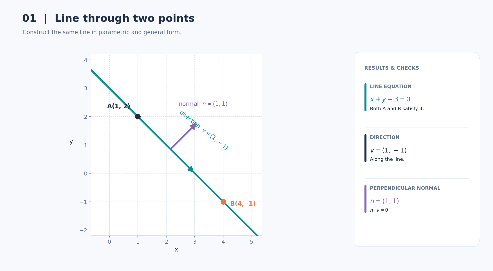

# Exercise 1. Line Through Two Points

## Question

Find the equation of the line through $A=(1,2)$ and $B=(4,-1)$ in parametric and general form. Identify a direction vector and an example of a normal vector. Check that both points satisfy the equation you obtain.

## Solution

### Given

Two distinct points in the coordinate plane: $A=(1,2)$ and $B=(4,-1)$.

### Find

A direction vector, a parametric description, a general equation $ax+by+c=0$, a normal vector, and a check for both given points.

### Method and steps

**Step 1. Construct a direction vector.** A line through two different points is directed by the displacement from one point to the other. Subtract the coordinates of the initial point from those of the final point:

$$
\begin{aligned}
\overrightarrow{AB}&=B-A\\
&=(4-1,-1-2)\\
&=(3,-3)=3(1,-1).
\end{aligned}
$$

Multiplying a direction vector by a nonzero number does not change the direction of the line. The simpler direction vector $v=(1,-1)$ can therefore be used.

**Step 2. Write the parametric equation.** Every point on the line is obtained by starting at $A$ and moving a real multiple of $v$:

$$
L:(x,y)=(1,2)+t(1,-1),\qquad t\in\mathbb{R}.
$$

Separating the coordinates gives

$$
\begin{cases}
x=1+t,\\
y=2-t.
\end{cases}
$$

**Step 3. Eliminate the parameter to obtain the general form.** Adding the coordinate equations cancels $t$:

$$
\begin{aligned}
x+y&=(1+t)+(2-t)\\
&=3.
\end{aligned}
$$

Moving all terms to one side produces the general equation

$$
x+y-3=0.
$$

**Step 4. Identify a normal vector.** For a line $ax+by+c=0$, the coefficient vector $n=(a,b)$ is perpendicular to the line. Here $n=(1,1)$. Check it against the direction vector:

$$
n\cdot v=(1,1)\cdot(1,-1)=1-1=0.
$$

This dot product confirms that $n$ is a normal vector.

**Step 5. Verify both points.** Substitute their coordinates into $x+y-3=0$:

$$
\begin{aligned}
A:&\quad 1+2-3=0,\\
B:&\quad 4+(-1)-3=0.
\end{aligned}
$$

The parametric form also reaches $A$ when $t=0$ and $B$ when $t=3$.

### Answer

$$
L:(x,y)=(1,2)+t(1,-1),\qquad t\in\mathbb{R}.
$$

$$
x+y-3=0,\qquad v=(1,-1),\qquad n=(1,1).
$$

Both given points satisfy the line equation.

## Geometric visualization

The line contains both marked points. The teal arrow follows its direction vector, and the purple normal arrow is perpendicular to it.
