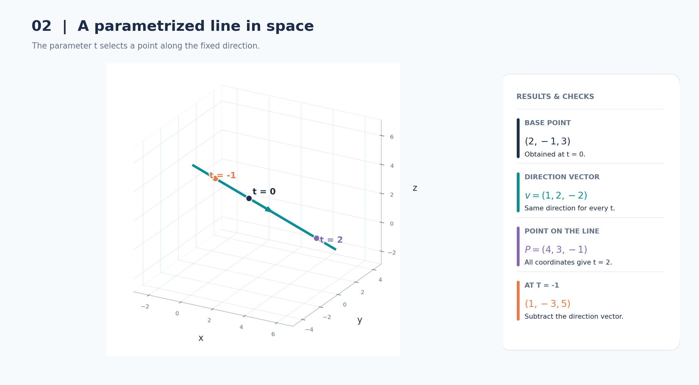

# Exercise 2. A Line in Space

## Question

Given

$$
L:(x,y,z)=(2,-1,3)+t(1,2,-2),
$$

state a point on the line and its direction vector, check whether $P=(4,3,-1)$ lies on $L$, and find the point corresponding to $t=-1$.

## Solution

### Given

A parametric line $L$ in three-dimensional space and a point $P=(4,3,-1)$.

### Find

One point on $L$, its direction vector, a membership test for $P$, and the point obtained by setting $t=-1$.

### Method and steps

**Step 1. Read the parametric representation.** In the expression $r=r_0+tv$, the fixed vector $r_0$ gives a point on the line when $t=0$, and $v$ gives its direction. Thus

$$
r_0=(2,-1,3),\qquad v=(1,2,-2).
$$

The coordinate equations are

$$
\begin{cases}
x=2+t,\\
y=-1+2t,\\
z=3-2t.
\end{cases}
$$

**Step 2. Test whether $P$ lies on $L$.** All three coordinate equations must hold for the same value of $t$. From the $x$-coordinate,

$$
4=2+t\quad\Rightarrow\quad t=2.
$$

Check this value in the other two coordinates:

$$
\begin{aligned}
y&=-1+2\cdot2=3,\\
z&=3-2\cdot2=-1.
\end{aligned}
$$

These match the $y$- and $z$-coordinates of $P$. Hence $P$ belongs to the line, with parameter $t=2$.

**Step 3. Evaluate the line at $t=-1$.** Substitute $-1$ into each coordinate:

$$
\begin{aligned}
x&=2+(-1)=1,\\
y&=-1+2(-1)=-3,\\
z&=3-2(-1)=5.
\end{aligned}
$$

The required point is $(1,-3,5)$.

**Step 4. Verify the displacement.** The point for $t=-1$ must differ from $r_0$ by $-v$:

$$
(1,-3,5)-(2,-1,3)=(-1,-2,2)=-(1,2,-2).
$$

This is exactly the expected change.

### Answer

A point on the line is $(2,-1,3)$, and its direction vector is $(1,2,-2)$. The point $P=(4,3,-1)$ lies on $L$ at $t=2$. At $t=-1$, the point is $(1,-3,5)$.

## Geometric visualization

The three marked positions correspond to $t=-1$, $t=0$, and $t=2$. They lie on one line directed by $v=(1,2,-2)$.
