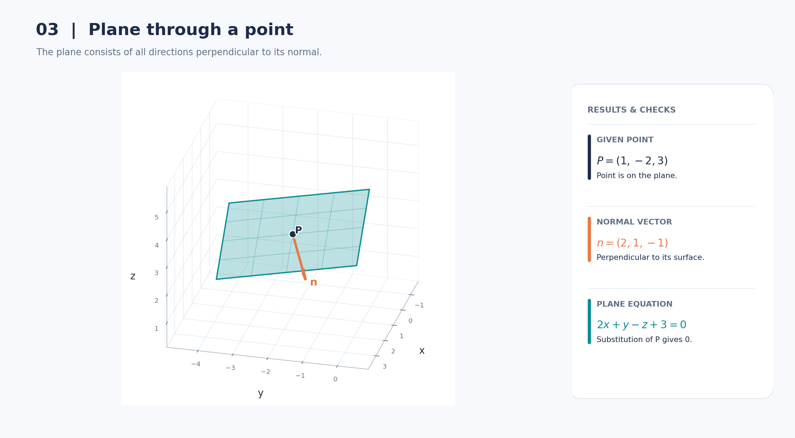

# Exercise 3. Plane Through a Point with a Given Normal Vector

## Question

Find the equation of the plane through $P=(1,-2,3)$ and perpendicular to $n=(2,1,-1)$. Check the result by substituting the point $P$ and explain the role of the normal vector.

## Solution

### Given

A point $P=(1,-2,3)$ and a nonzero normal vector $n=(2,1,-1)$.

### Find

A Cartesian equation of the plane, a substitution check for $P$, and the geometric meaning of $n$.

### Method and steps

**Step 1. Recall the point-normal equation.** If the plane passes through $P=(x_0,y_0,z_0)$ and has normal vector $n=(a,b,c)$, then every point $X=(x,y,z)$ of the plane satisfies

$$
n\cdot\overrightarrow{PX}=0.
$$

The vector from $P$ to any point $X$ on the plane lies inside the plane and is therefore perpendicular to the normal.

**Step 2. Substitute the given data.** The displacement vector is

$$
\overrightarrow{PX}=(x-1,y+2,z-3).
$$

Taking the dot product with $n$ gives

$$
2(x-1)+(y+2)-(z-3)=0.
$$

**Step 3. Simplify the equation.** Expand the brackets and collect the constants:

$$
\begin{aligned}
2x-2+y+2-z+3&=0,\\
2x+y-z+3&=0.
\end{aligned}
$$

An equivalent form is $2x+y-z=-3$.

**Step 4. Check the point $P$.** Substitute $(1,-2,3)$ into the equation:

$$
2\cdot1+(-2)-3+3=2-2-3+3=0.
$$

Thus the required point lies on the plane.

**Step 5. Explain the normal vector.** The coefficients of $x,y,z$ are $(2,1,-1)$, which are the components of $n$. Any two points in the plane determine a vector $w$ with $n\cdot w=0$. Consequently, the normal describes the plane's orientation, while the given point fixes its position.

### Answer

$$
\Pi:2x+y-z+3=0.
$$

Its normal vector is $n=(2,1,-1)$, and $P$ satisfies the equation.

## Geometric visualization

The orange arrow represents the normal $n=(2,1,-1)$ at $P$; the translucent surface represents the plane through that point.
