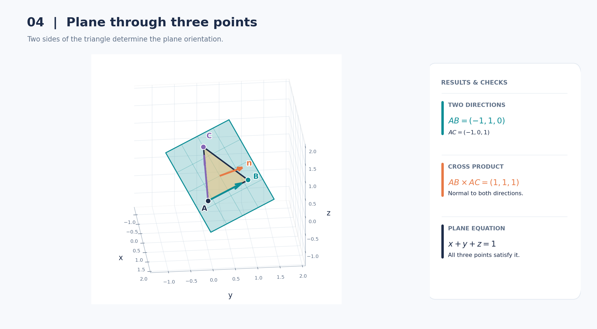

# Exercise 4. Plane Through Three Points

## Question

Find the equation of the plane through

$$
A=(1,0,0),\qquad B=(0,1,0),\qquad C=(0,0,1).
$$

First construct two vectors lying in the plane, and then use the cross product. Check the resulting equation on all three points.

## Solution

### Given

Three points $A=(1,0,0)$, $B=(0,1,0)$, and $C=(0,0,1)$.

### Find

Two direction vectors in their plane, a normal vector found by a cross product, the plane equation, and checks for all three points.

### Method and steps

**Step 1. Construct two vectors in the plane.** Start both vectors at $A$:

$$
\begin{aligned}
\overrightarrow{AB}&=B-A=(-1,1,0),\\
\overrightarrow{AC}&=C-A=(-1,0,1).
\end{aligned}
$$

These vectors are not parallel, so they determine a unique plane through $A$.

**Step 2. Obtain a normal with the cross product.** For vectors $u=(u_1,u_2,u_3)$ and $v=(v_1,v_2,v_3)$,

$$
u\times v=(u_2v_3-u_3v_2,\;u_3v_1-u_1v_3,\;u_1v_2-u_2v_1).
$$

Substituting the two vectors gives

$$
\begin{aligned}
\overrightarrow{AB}\times\overrightarrow{AC}
&=(1\cdot1-0\cdot0,\;0\cdot(-1)-(-1)\cdot1,\;(-1)\cdot0-1\cdot(-1))\\
&=(1,1,1).
\end{aligned}
$$

Therefore $n=(1,1,1)$ is a normal vector.

**Step 3. Write the plane equation.** Use the point $A$ and the normal $n$:

$$
1(x-1)+1(y-0)+1(z-0)=0.
$$

After simplification,

$$
x+y+z=1.
$$

**Step 4. Verify all three points.** Substitute each point separately:

$$
\begin{aligned}
A:&\quad 1+0+0=1,\\
B:&\quad 0+1+0=1,\\
C:&\quad 0+0+1=1.
\end{aligned}
$$

Every point satisfies the equation.

**Step 5. Check the normal direction.** It is perpendicular to both constructed vectors:

$$
\begin{aligned}
n\cdot\overrightarrow{AB}&=(1,1,1)\cdot(-1,1,0)=-1+1+0=0,\\
n\cdot\overrightarrow{AC}&=(1,1,1)\cdot(-1,0,1)=-1+0+1=0.
\end{aligned}
$$

### Answer

$$
\Pi:x+y+z=1,\qquad n=(1,1,1).
$$

The plane contains $A,B,C$, and its normal is perpendicular to both spanning vectors.

## Geometric visualization

The two colored arrows starting at $A$ lie in the triangle plane. Their cross product gives the orange normal direction.
