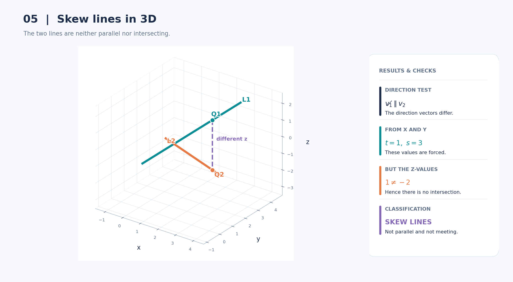

# Exercise 5. Relative Position of Two Lines

## Question

Analyze the position of

$$
L_1:(x,y,z)=(1,1,0)+t(1,2,1),
$$

$$
L_2:(x,y,z)=(2,0,1)+s(0,1,-1).
$$

If they intersect, give the intersection point. If not, determine whether they are parallel or skew. Justify the classification.

## Solution

### Given

Two parametric lines in three-dimensional space, with independent parameters $t$ and $s$.

### Find

Whether the lines intersect, are parallel, or are skew; if they intersect, the common point.

### Method and steps

**Step 1. Read their points and direction vectors.** For the first line,

$$
p_1=(1,1,0),\qquad v_1=(1,2,1).
$$

For the second line,

$$
p_2=(2,0,1),\qquad v_2=(0,1,-1).
$$

**Step 2. Test parallelism.** Parallel lines have proportional direction vectors. Since the first coordinate of $v_1$ is $1$ and the first coordinate of $v_2$ is $0$, no nonzero scalar can make $v_1$ equal to a multiple of $v_2$. Therefore the two lines are **not parallel**.

**Step 3. Test intersection by matching coordinates.** A common point requires

$$
(1+t,\;1+2t,\;t)=(2,\;s,\;1-s).
$$

This yields a system in $t$ and $s$:

$$
\begin{cases}
1+t=2,\\
1+2t=s,\\
t=1-s.
\end{cases}
$$

**Step 4. Solve the first two equations and check the third.** The first equation gives $t=1$. The second then gives $s=1+2\cdot1=3$. The third equation would require

$$
1=1-3=-2,
$$

which is false. No pair $(t,s)$ satisfies all three coordinate equations simultaneously, so the lines do **not** intersect.

**Step 5. Classify the lines.** Two lines in space that are neither parallel nor intersecting are called *skew lines*. They cannot lie in the same plane. For an additional geometric check, take

$$
\begin{aligned}
v_1\times v_2&=(1,2,1)\times(0,1,-1)=(-3,1,1),\\
p_2-p_1&=(1,-1,1).
\end{aligned}
$$

The scalar triple product is

$$
(p_2-p_1)\cdot(v_1\times v_2)=(1,-1,1)\cdot(-3,1,1)=-3-1+1=-3\neq0.
$$

This confirms that the two lines are not coplanar.

### Answer

The lines $L_1$ and $L_2$ are **skew**: they are not parallel and have no intersection point.

## Geometric visualization

The dashed segment connects the two points forced by the first two coordinate equations: $Q_1=(2,3,1)$ and $Q_2=(2,3,-2)$. Because their $z$-coordinates differ, they are not an intersection. The dashed segment is a coordinate comparison, not a shortest-distance construction.
