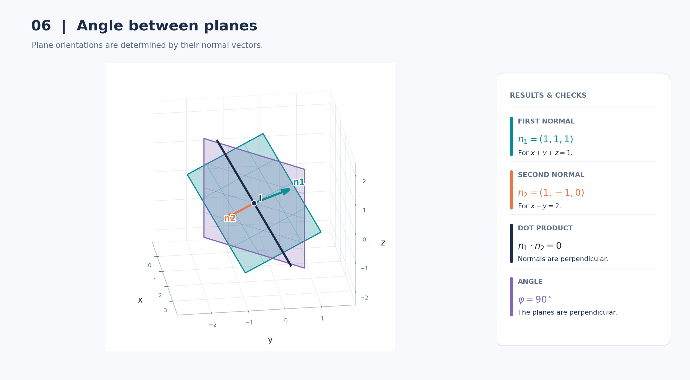

# Exercise 6. Angle Between Planes

## Question

Given

$$
\Pi_1:x+y+z=1,\qquad \Pi_2:x-y=2.
$$

First use the normal vectors to decide whether the planes are parallel. If not, compute the angle between them and explain why the normal vectors alone are enough for this calculation.

## Solution

### Given

Two planes $\Pi_1:x+y+z=1$ and $\Pi_2:x-y=2$.

### Find

A parallelism test using normals, the (smaller) angle between the planes, and an explanation of the method.

### Method and steps

**Step 1. Identify both normals.** In a plane equation $ax+by+cz=d$, the coefficients give a normal vector $n=(a,b,c)$. Hence

$$
n_1=(1,1,1),\qquad n_2=(1,-1,0).
$$

**Step 2. Test whether the planes are parallel.** Two planes are parallel if their normals are proportional. Here $n_1$ and $n_2$ are not proportional: their third components are $1$ and $0$, respectively, while both normals are nonzero. Therefore the planes are not parallel.

**Step 3. Calculate the dot product.** The dot product is

$$
\begin{aligned}
n_1\cdot n_2&=1\cdot1+1\cdot(-1)+1\cdot0\\
&=1-1+0=0.
\end{aligned}
$$

Thus the normal vectors are perpendicular.

**Step 4. Apply the plane-angle formula.** The smaller angle $\varphi$ between planes lies in $[0^\circ,90^\circ]$ and satisfies

$$
\cos\varphi=\frac{|n_1\cdot n_2|}{\|n_1\|\,\|n_2\|}.
$$

The normal lengths are $\|n_1\|=\sqrt3$ and $\|n_2\|=\sqrt2$. Substituting,

$$
\cos\varphi=\frac{0}{\sqrt3\sqrt2}=0.
$$

Therefore

$$
\varphi=\arccos(0)=90^\circ=\frac\pi2.
$$

**Step 5. Explain why normals are sufficient.** Each normal is perpendicular to its plane, so the relative orientation of the two planes is determined by the relative orientation of their normals. The position constants $1$ and $2$ shift the planes but do not change their directions or their mutual angle.

### Answer

The planes are not parallel; they are **perpendicular**, and their smaller angle is $90^\circ$.

## Geometric visualization

The translucent planes meet along the dark line. Their orange and teal normal arrows are perpendicular because $n_1\cdot n_2=0$. Perspective can distort the apparent angle, but the calculation is exact.
