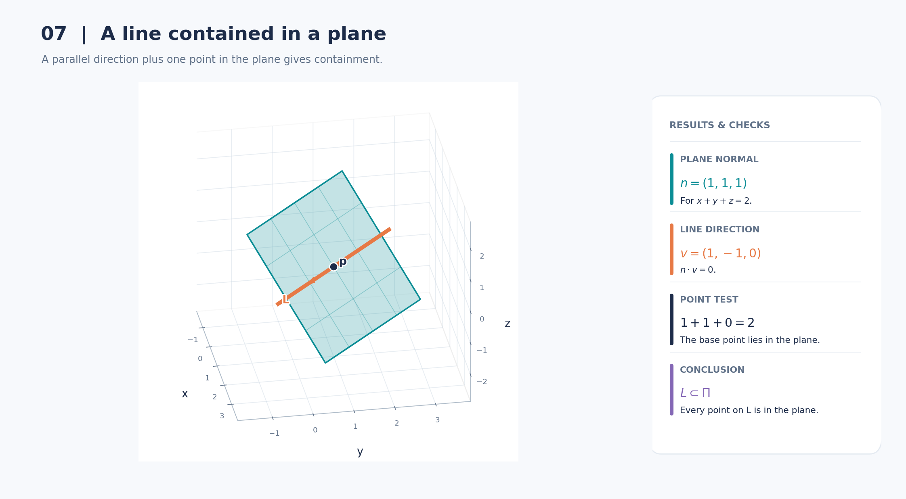

# Exercise 7. A Line Relative to a Plane

## Question

For

$$
L:(x,y,z)=(1,1,0)+t(1,-1,0),\qquad \Pi:x+y+z=2,
$$

determine whether the line intersects the plane at one point, is parallel to it, or lies in it. Explain the role of the dot product of the direction vector and the normal vector.

## Solution

### Given

A line through $p=(1,1,0)$ with direction $v=(1,-1,0)$ and a plane $\Pi:x+y+z=2$.

### Find

The relative position of the entire line and the plane, justified using a dot product and a point test.

### Method and steps

**Step 1. Identify the plane normal.** The coefficients of $x,y,z$ give

$$
n=(1,1,1).
$$

**Step 2. Test the line direction against the normal.** Compute

$$
\begin{aligned}
n\cdot v&=(1,1,1)\cdot(1,-1,0)\\
&=1-1+0=0.
\end{aligned}
$$

Because the dot product is zero, the direction vector is perpendicular to the normal. Therefore the line direction is parallel to the plane. This condition by itself does **not** distinguish a line lying in the plane from a line parallel to it at a different position.

**Step 3. Test a point on the line.** The line contains $p=(1,1,0)$ at $t=0$. Substitute this point into the plane equation:

$$
1+1+0=2.
$$

The point belongs to the plane. Since the direction is parallel to the plane and a point of the line lies in the plane, the **entire line lies in the plane**.

**Step 4. Verify directly for an arbitrary parameter.** The line coordinates are

$$
(x,y,z)=(1+t,1-t,0).
$$

Substitute into $x+y+z$:

$$
(1+t)+(1-t)+0=2.
$$

This equality holds for every $t\in\mathbb{R}$, which confirms the classification.

### Answer

$$
L\subset\Pi.
$$

The line lies in the plane. The dot product $n\cdot v=0$ establishes a parallel direction; the point test confirms containment.

## Geometric visualization

The orange line lies entirely on the translucent plane. Its direction is orthogonal to the plane normal, and its marked point belongs to the plane.
