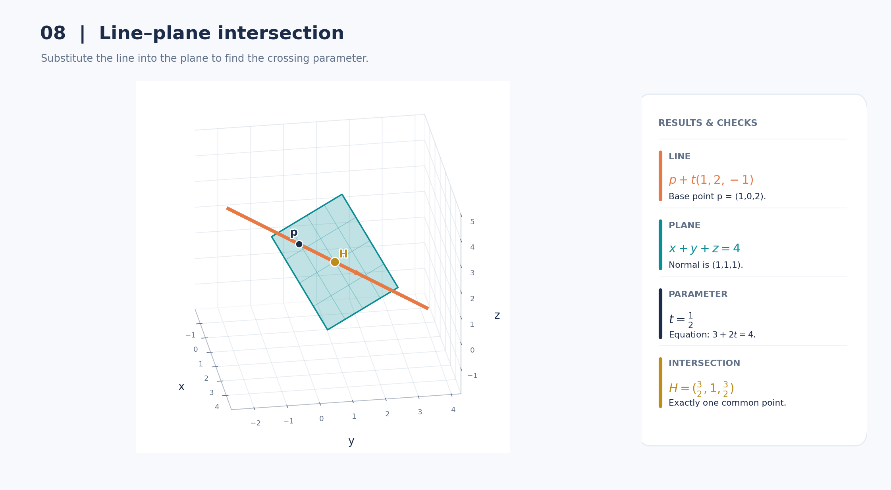

# Exercise 8. Intersection Point of a Line and a Plane

## Question

Find the intersection point of

$$
(x,y,z)=(1,0,2)+t(1,2,-1)
$$

with the plane $x+y+z=4$. Check the result by substituting it into both descriptions.

## Solution

### Given

A line through $p=(1,0,2)$ with direction $v=(1,2,-1)$ and the plane $\Pi:x+y+z=4$.

### Find

The intersection parameter $t$, the intersection point, and checks for both the line and the plane.

### Method and steps

**Step 1. Write separate coordinate equations.** The vector equation means

$$
\begin{cases}
x=1+t,\\
y=2t,\\
z=2-t.
\end{cases}
$$

**Step 2. Insert the parametric coordinates into the plane equation.** Every intersection point must satisfy $x+y+z=4$, so

$$
(1+t)+2t+(2-t)=4.
$$

Collect constant and parameter terms:

$$
3+2t=4.
$$

**Step 3. Solve for the parameter.** Subtract $3$ and divide by $2$:

$$
2t=1\quad\Rightarrow\quad t=\frac12.
$$

**Step 4. Calculate the intersection point.** Substitute $t=\frac12$ into the line:

$$
\begin{aligned}
x&=1+\frac12=\frac32,\\
y&=2\cdot\frac12=1,\\
z&=2-\frac12=\frac32.
\end{aligned}
$$

Therefore the candidate point is

$$
H=\left(\frac32,1,\frac32\right).
$$

**Step 5. Check both descriptions.** The point comes from the line at $t=\frac12$ because

$$
(1,0,2)+\frac12(1,2,-1)=\left(\frac32,1,\frac32\right).
$$

It also lies in the plane because

$$
\frac32+1+\frac32=4.
$$

**Step 6. Explain uniqueness.** The plane normal is $n=(1,1,1)$. Since

$$
n\cdot v=1+2-1=2\neq0,
$$

the line is not parallel to the plane and meets it in exactly one point.

### Answer

$$
L\cap\Pi=\left\{\left(\frac32,1,\frac32\right)\right\}.
$$

## Geometric visualization

The orange line crosses the translucent plane at the marked point $H=(\frac{3}{2},1,\frac{3}{2})$. There is exactly one intersection because $n\cdot v=2\neq0$.
