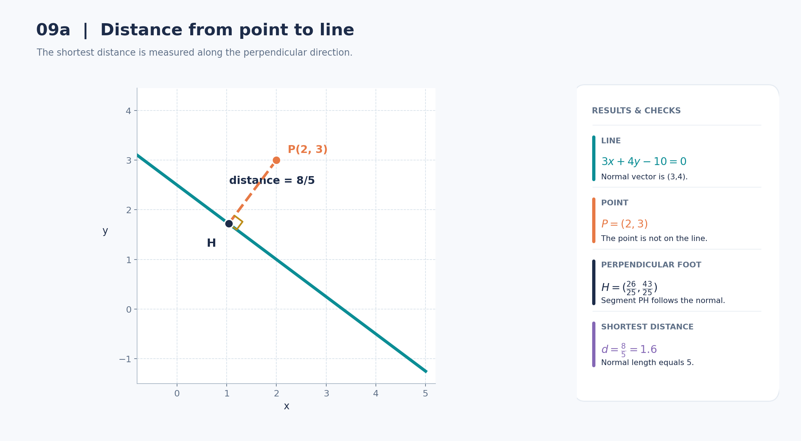
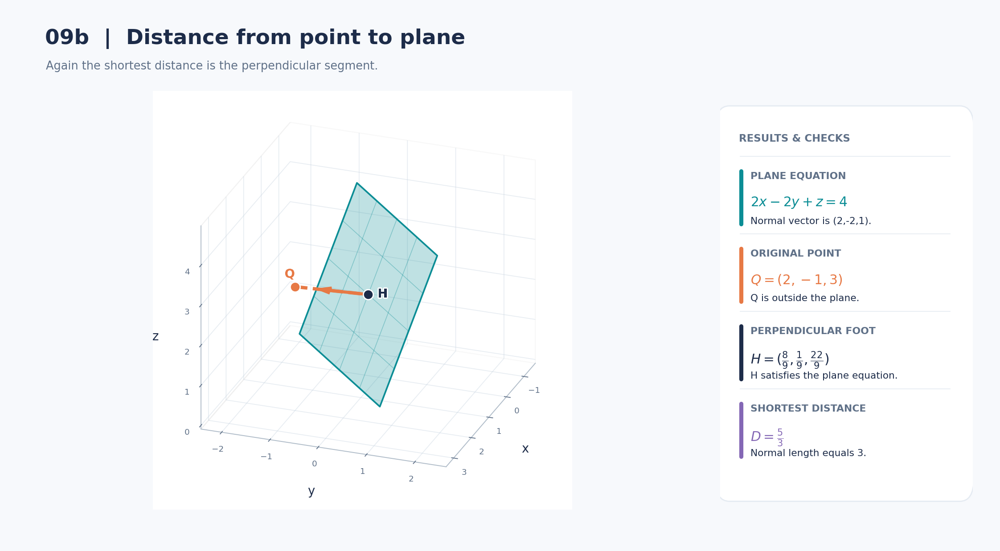

# Exercise 9. Distances

## Question

Compute:

1. the distance from $P=(2,3)$ to the line $3x+4y-10=0$;
2. the distance from $Q=(2,-1,3)$ to the plane $2x-2y+z-4=0$.

Compare the two formulas and explain their common connection with the normal direction.

## Solution

### Given

A point $P=(2,3)$ and a line $3x+4y-10=0$ in the plane; a point $Q=(2,-1,3)$ and a plane $2x-2y+z-4=0$ in space.

### Find

Both shortest distances and an explanation of the shared geometric mechanism.

### Method and steps

**Step 1. Recall the point-to-line formula in two dimensions.** If the line has equation $ax+by+c=0$ and the point is $(x_0,y_0)$, then its distance from the line is

$$
d=\frac{|ax_0+by_0+c|}{\sqrt{a^2+b^2}}.
$$

The numerator is the absolute value of the line expression at the point, and the denominator is the length of the normal vector $(a,b)$.

**Step 2. Calculate the distance from $P$ to the line.** With $a=3$, $b=4$, $c=-10$, $P=(2,3)$,

$$
\begin{aligned}
d(P,L)&=\frac{|3\cdot2+4\cdot3-10|}{\sqrt{3^2+4^2}}\\
&=\frac{|6+12-10|}{\sqrt{9+16}}\\
&=\frac8{5}.
\end{aligned}
$$

The distance is $\frac85=1.6$ units.

**Step 3. Recall the point-to-plane formula in three dimensions.** For a plane $ax+by+cz+d=0$ and a point $(x_0,y_0,z_0)$,

$$
D=\frac{|ax_0+by_0+cz_0+d|}{\sqrt{a^2+b^2+c^2}}.
$$

The denominator is the length of the plane's normal vector $(a,b,c)$.

**Step 4. Calculate the distance from $Q$ to the plane.** The normal is $n=(2,-2,1)$, with length

$$
\|n\|=\sqrt{2^2+(-2)^2+1^2}=\sqrt9=3.
$$

Substitute $Q=(2,-1,3)$ into the plane expression:

$$
2\cdot2-2(-1)+3-4=4+2+3-4=5.
$$

Therefore

$$
\begin{aligned}
D(Q,\Pi)&=\frac{|5|}{3}\\
&=\frac53.
\end{aligned}
$$

**Step 5. Explain the common geometry.** In both cases the shortest segment from the given point to the line or plane points in a **normal direction**. If the equation is written as $n\cdot x+d=0$, the quantity $n\cdot p+d$ measures a signed normal displacement multiplied by $\|n\|$. Taking the absolute value and dividing by $\|n\|$ gives the perpendicular distance. In two dimensions the normal has two coordinates; in three dimensions it has three.

**Step 6. Optional geometric check using perpendicular feet.** For the line, the perpendicular foot is

$$
\begin{aligned}
H_L&=P-\frac{3\cdot2+4\cdot3-10}{3^2+4^2}(3,4)\\
&=(2,3)-\frac8{25}(3,4)\\
&=\left(\frac{26}{25},\frac{43}{25}\right).
\end{aligned}
$$

Its coordinates satisfy $3x+4y-10=0$, and

$$
\|P-H_L\|=\frac8{25}\sqrt{3^2+4^2}=\frac85.
$$

For the plane, the perpendicular foot is

$$
\begin{aligned}
H_\Pi&=Q-\frac{2\cdot2-2(-1)+3-4}{2^2+(-2)^2+1^2}(2,-2,1)\\
&=(2,-1,3)-\frac59(2,-2,1)\\
&=\left(\frac89,\frac19,\frac{22}{9}\right).
\end{aligned}
$$

The plane equation holds at $H_\Pi$ because $\frac{16}{9}-\frac29+\frac{22}{9}-4=0$. Also

$$
\|Q-H_\Pi\|=\frac59\sqrt{2^2+(-2)^2+1^2}=\frac53.
$$

### Answer

$$
d(P,L)=\frac85,\qquad D(Q,\Pi)=\frac53.
$$

Both formulas measure the length of a displacement perpendicular to the relevant geometric object.

## Geometric visualization

**Distance to a line**

**Distance to a plane**

Both panels mark the perpendicular foot $H$. The dashed segment follows the relevant normal direction and has the shortest possible length.
