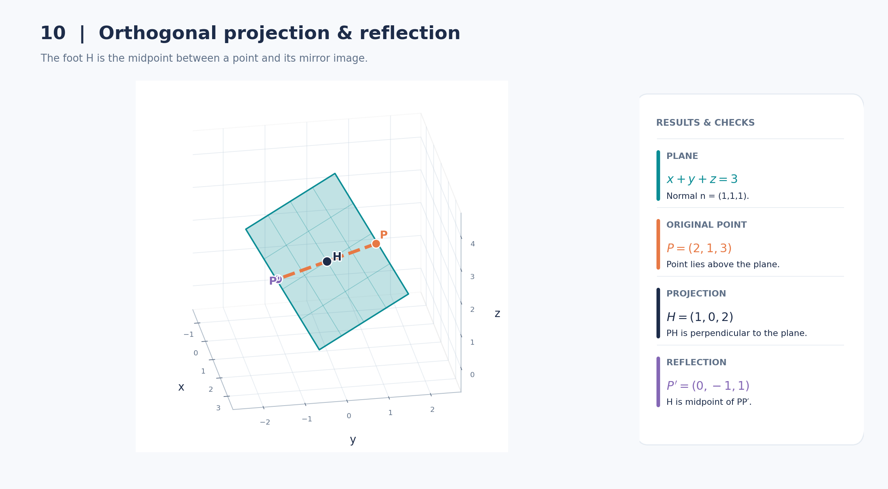

# Exercise 10. Projection of a Point onto a Plane

## Question

Find the orthogonal projection of $P=(2,1,3)$ onto the plane $x+y+z=3$, and then find the reflection of $P$ across this plane. Check that the midpoint of the segment joining the point and its reflection lies on the plane.

## Solution

### Given

The point $P=(2,1,3)$ and the plane $\Pi:x+y+z=3$.

### Find

The orthogonal projection $H$ of $P$ onto $\Pi$, the reflected point $P'$, and a midpoint verification.

### Method and steps

**Step 1. Identify the normal.** The plane equation has coefficient vector

$$
n=(1,1,1).
$$

A perpendicular segment to the plane is parallel to $n$. Therefore the projection must lie on the line $P-\lambda n$ for some real number $\lambda$.

**Step 2. Parameterize the normal line through $P$.** Write

$$
H=P-\lambda n=(2-\lambda,1-\lambda,3-\lambda).
$$

To determine $\lambda$, require $H$ to lie on the plane.

**Step 3. Solve for the projection parameter.** Substituting the coordinates of $H$ into $x+y+z=3$ yields

$$
(2-\lambda)+(1-\lambda)+(3-\lambda)=3.
$$

Simplify:

$$
6-3\lambda=3\quad\Rightarrow\quad3\lambda=3\quad\Rightarrow\quad\lambda=1.
$$

Hence

$$
H=(2-1,1-1,3-1)=(1,0,2).
$$

**Step 4. Verify orthogonality and membership.** The point $H$ lies in the plane because

$$
1+0+2=3.
$$

The segment from $H$ to $P$ is

$$
P-H=(2,1,3)-(1,0,2)=(1,1,1)=n.
$$

It is parallel to the normal, so the segment is perpendicular to the plane. Therefore $H$ is the orthogonal projection.

**Step 5. Find the reflected point.** Reflection across the plane places $P'$ on the opposite side of $H$ at the same distance. Thus $H$ is the midpoint of $P$ and $P'$, and

$$
P'=2H-P.
$$

Calculate coordinate by coordinate:

$$
\begin{aligned}
P'&=2(1,0,2)-(2,1,3)\\
&=(2,0,4)-(2,1,3)\\
&=(0,-1,1).
\end{aligned}
$$

**Step 6. Check the midpoint.** Calculate the midpoint of $P=(2,1,3)$ and $P'=(0,-1,1)$:

$$
\begin{aligned}
M&=\frac{P+P'}2\\
&=\left(\frac{2+0}{2},\frac{1+(-1)}2,\frac{3+1}2\right)\\
&=(1,0,2)=H.
\end{aligned}
$$

Finally, $1+0+2=3$ confirms that the midpoint lies on the plane. The symmetry can also be checked by $H-P=(-1,-1,-1)$ and $P'-H=(-1,-1,-1)$: the two consecutive segments have the same direction and length.

### Answer

$$
H=(1,0,2),\qquad P'=(0,-1,1).
$$

The midpoint of $PP'$ is $H$, which satisfies $x+y+z=3$.

## Geometric visualization

The original point $P$, orthogonal projection $H$, and reflected point $P^{\prime}$ lie on a normal line. The plane passes through the midpoint $H$.
